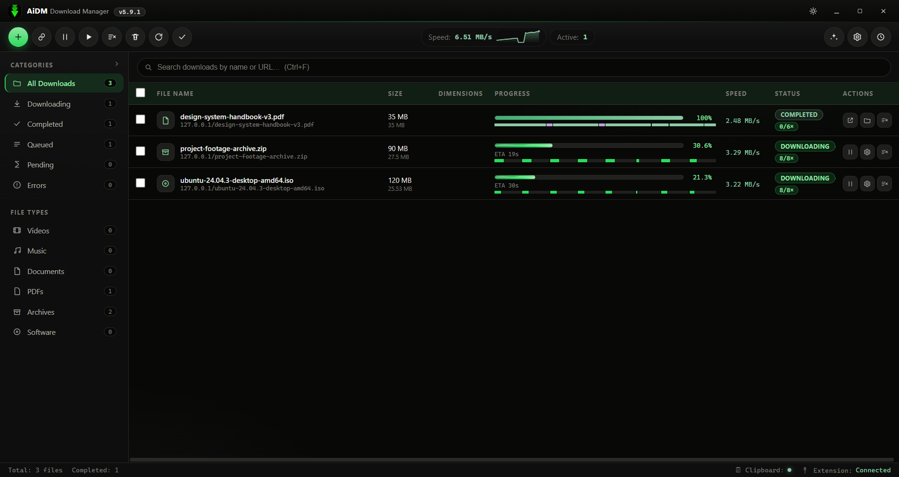
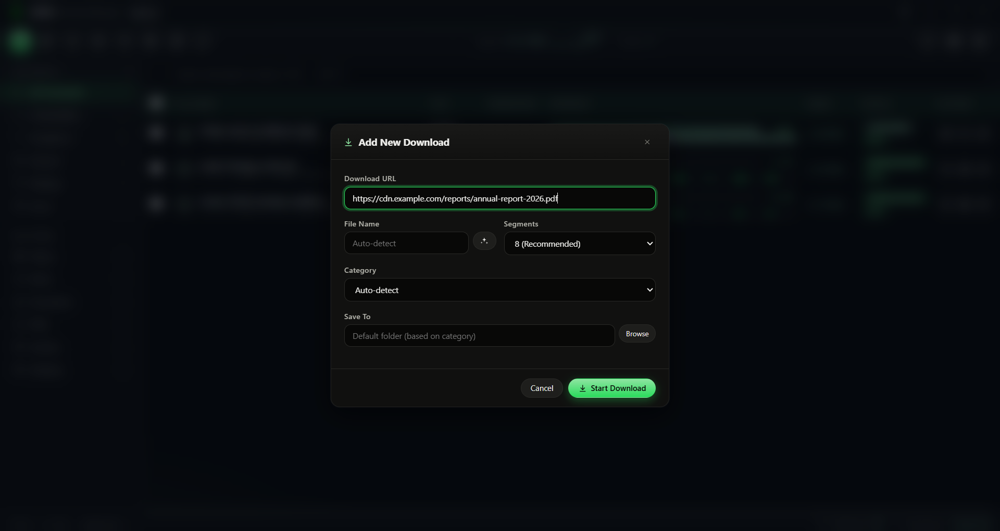
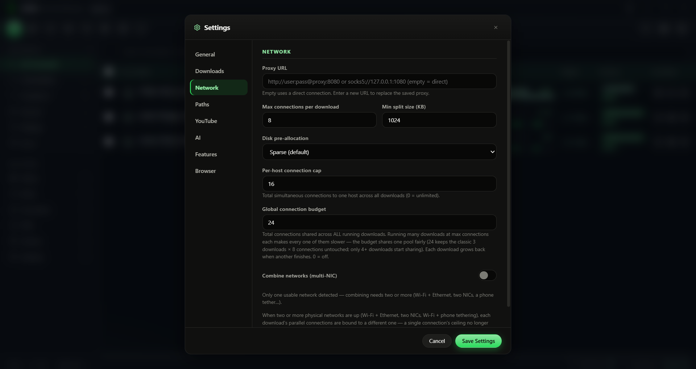
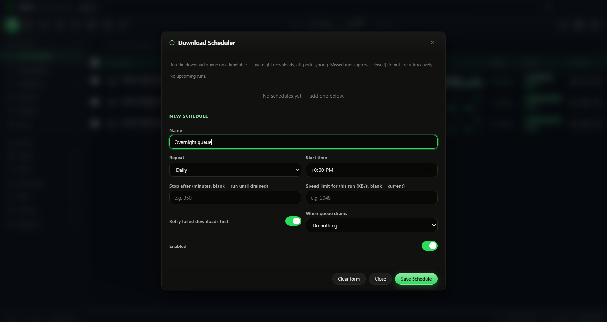
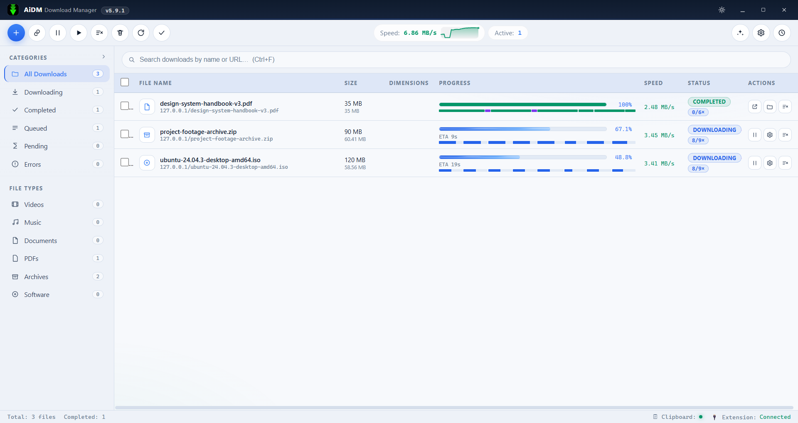

# ⚡ AiDM — AI-Powered Download Manager v6.0.0

> Classic IDM-style download manager with a next-generation modular download engine, dynamic in-flight segment splitting, positional random-access disk I/O, multi-mirror failover, atomic `.part.meta` crash recovery, Chrome browser integration, video quality detection, a yt-dlp + FFmpeg extraction engine for YouTube, a gallery-dl engine for 250+ gallery sites, Udemy course downloads, smart per-category file organization, ETA, dual-layer speed limiting, and streaming multi-algorithm checksum verification.

<p align="center">
  
</p>

## 📸 Screenshots

| | |
|---|---|
|  |  |
| *Add New Download — batch paste, segments, per-category save paths* | *Settings — connection caps, speed limits, proxy, global connection budget* |
|  |  |
| *Download Scheduler — one-time / daily / weekly queue runs* | *The same UI in the light theme (one click in the titlebar)* |

---

## 📜 Changelog

Every release, with what changed and why, lives in **[CHANGELOG.md](CHANGELOG.md)**
(newest first — v6.0.0 down to v3.0.0).


## 📊 Research: Top 5 Download Managers Analyzed

AiDM was built by analyzing and combining the best technologies from the world's top download managers:

### 1. 🏆 Internet Download Manager (IDM)
- **Dynamic File Segmentation** — Splits files into multiple segments and downloads them in parallel
- **Smart Connection Reuse** — Keeps HTTP connections alive to avoid handshake overhead
- **Browser Integration** — Native extension intercepts all browser downloads automatically
- **Resume Capability** — Full resume support via HTTP Range headers

### 2. 🆓 Free Download Manager (FDM)
- **Modern Electron UI** — Clean, responsive interface built on web technologies
- **Smart File Management** — Automatic categorization by file type
- **Traffic Shaping** — Bandwidth allocation and speed limiting per download

### 3. 📋 JDownloader 2
- **Clipboard Monitoring** — Automatically detects download URLs copied to clipboard
- **Link Grabber** — Extracts all downloadable links from any webpage
- **Batch Processing** — Download entire link lists with one click

### 4. 🎬 Xtreme Download Manager (XDM)
- **Video Stream Detection** — Detects and downloads streaming video (HLS, DASH, progressive)
- **Video Sniffer** — Monitors network traffic for video streams in real-time

### 5. ⚡ Motrix
- **Electron architecture** — Cross-platform desktop app
- **Local API server** — HTTP API for extension ↔ app communication

---

## 🔧 AiDM Features

| Feature | Inspired By | Implementation |
|---------|-------------|----------------|
| Multi-segment downloading | IDM | 1-32 parallel segments with dynamic allocation |
| Byte-accurate resume | IDM | Per-segment offset tracking across retries and restarts |
| Intercept ALL downloads | IDM | Every browser download routes to AiDM automatically |
| Video quality detection | XDM | Detects resolution, quality (4K/1080p/720p), file size |
| Quality picker | XDM | Choose video quality before downloading |
| Per-category paths | FDM | Auto-save Videos→Videos/, Music→Music/, etc. |
| Ask location every time | IDM | Optional folder picker for each download |
| Clipboard monitoring | JDownloader | Auto-detects URLs copied to clipboard |
| Video stream detection | XDM | Content script monitors page resources in real-time |
| Link grabber | JDownloader | Scans pages for all downloadable links |
| Batch downloads | JDownloader | Download multiple URLs at once |
| SHA-256 verification | — | Background hash after completion |
| Speed limiting | FDM | Token-bucket global throttle |
| ETA | IDM | Estimated time remaining per download |
| Drag-and-drop | — | Drop URLs/files onto the window |
| Local API server | Motrix | HTTP API on port 18765 for extension ↔ app |
| **MCP server for AI assistants** | MDM / Swift DM / Gopeed | 12 tools over the Model Context Protocol — off by default, token-protected, access levels, audit log ([docs](docs/MCP.md)) |

---

## 📁 Project Structure

```
aidm/
├── main.js                    # Electron main process
├── preload.js                 # Secure IPC bridge
├── preload-location.js        # IPC bridge for the location dialog
├── package.json               # Dependencies & build config
├── src/
│   ├── download-engine.js     # Unified download engine API (v4 modular + legacy compat)
│   ├── download-manager.js    # Queue, scheduling, categories, approval flow
│   ├── clipboard-monitor.js   # Clipboard URL detection
│   ├── server.js              # Local HTTP API for Chrome extension
│   ├── ai-service.js          # TokenHarbor AI integration
│   ├── resolvers.js           # Media resolver registry & base provider
│   ├── twitter-resolver.js    # Twitter/X syndication video resolver
│   ├── youtube-resolver.js    # YouTube URL normalisation + yt-dlp format mapping
│   ├── yt-dlp.js              # yt-dlp runner (detect, probe, download, merge, kill)
│   ├── media-mux.js           # FFmpeg (ffmpeg-static) remux helper
│   ├── location-dialog.js     # Topmost save-location window controller
│   ├── mcp/                   # MCP server — AI assistants (protocol, tools, safety, bridge)
│   └── engine/                # Next-Gen Modular Engine Core
│       ├── types.js           # Type definitions & engine defaults
│       ├── errors.js          # DownloadError classification & HTTP mappings
│       ├── utils.js           # Math, deferred promises, safe paths
│       ├── checksum.js        # Streaming multi-hash verifier (MD5, SHA1, SHA256, SHA512)
│       ├── control-file.js    # Atomic crash recovery (.part.meta)
│       ├── file-writer.js     # Positional random-access SegmentFileWriter
│       ├── rate-limiter.js    # Token-bucket rate limiter with burst control
│       ├── retry.js           # Exponential backoff with jitter & Retry-After
│       ├── speed.js           # Sliding-window & EMA speed calculations + ETA
│       ├── mirrors.js         # MirrorPool failover & speed scoring
│       ├── probe.js           # Remote HTTP/HTTPS HEAD & Range probe
│       ├── segments.js        # SegmentManager with dynamic in-flight splitting
│       ├── worker.js          # Positional byte stream segment worker
│       ├── task.js            # DownloadTask lifecycle coordinator
│       └── engine.js          # Multi-download DownloadEngine coordinator
├── ui/
│   ├── index.html             # Main window
│   ├── styles.css             # IDM-inspired light-blue theme
│   ├── app.js                 # UI controller
│   ├── location-dialog.html   # Save-location dialog markup
│   └── location-dialog.js     # Save-location dialog renderer
├── chrome-extension/
│   ├── manifest.json          # Extension manifest (MV3)
│   ├── background.js          # Service worker — intercepts ALL downloads
│   ├── interceptor.js         # MAIN-world media URL hooks
│   ├── content.js             # Video detection + floating capsule
│   ├── popup.html / popup.js  # Extension popup
│   └── icon*.png              # Extension icons
├── test/
│   ├── smoke.js               # Core unit tests (60 assertions)
│   ├── integration.js         # Live multi-segment, pause, resume & restart tests (13 assertions)
│   └── engine-v4.js           # Next-gen engine unit & integration tests (37 assertions)
└── README.md
```

---

## 🚀 Installation & Running

### Prerequisites
- **Node.js 18+** and npm (the Electron 45 runtime itself is installed by `npm install`)
- Windows 10/11 for the packaged installer; running from source works anywhere Electron runs
- Google Chrome (optional — for the browser-integration extension)

### Run from source

```bash
git clone https://github.com/manjayofficial01-ui/AiDM.git
cd AiDM
npm install
npm start
```

- `npm run dev` — the same app with dev flags
- `npm test` — the full regression suite (100+ suites)

### Optional: video & gallery engines
AiDM **never bundles** yt-dlp or gallery-dl. YouTube / long-tail video extraction
needs the official yt-dlp release — one command installs it into a per-user
folder, SHA-256 verified against the published checksums:

```bash
node tools/fetch-yt-dlp.js
```

gallery-dl (250+ gallery sites) is offered from **Settings › gallery-dl** inside
the app; FFmpeg ships pre-bundled via `ffmpeg-static`, nothing to install.

### Install as a Windows desktop app

Build the NSIS installer once, then run it like any Windows installer:

```bash
npm run dist:win        # → dist/AiDM-Setup-<version>.exe
```

`AiDM-Setup-<version>.exe` walks you through per-user or all-users (UAC)
installation with a directory picker, creates desktop / Start-menu shortcuts,
and can keep AiDM alive in the tray when the window is closed (Settings ›
General). Re-running a newer Setup upgrades in place — settings and download
history survive, since they live in `~/.aidm_downloads.json` and
`~/.aidm_settings.json`, never inside the install folder.

### Chrome extension (browser integration)
1. **Start the AiDM desktop app first** — the extension talks to it on `127.0.0.1:18765`
2. Open Chrome → `chrome://extensions/`
3. Enable **Developer mode** (top right)
4. Click **Load unpacked** and select the `chrome-extension/` folder
5. The AiDM icon appears in your toolbar
6. **After every AiDM update:** hit ⟳ Reload on the extension, then reload open video tabs

### Usage
1. **Add downloads:** the ＋ button (`Ctrl+N`), drag-and-drop a URL onto the window, paste a batch (one URL per line), or just copy a link — the clipboard monitor catches it
2. **In the browser:** right-click any link → *Download with AiDM*, click the floating pill on a playing video, or use the popup's *Scan Page* / *Grab Site*
3. **Automate:** ⏰ runs the queue on a one-time / daily / weekly timetable, and `AiDM.exe <url> [<url>…]` queues from the command line

---

## 🏗️ Architecture

```
┌─────────────────────────────────────────────┐
│              Chrome Browser                   │
│  ┌─────────────────────────────────────┐    │
│  │     AiDM Chrome Extension           │    │
│  │  • Download interceptor             │    │
│  │  • Context menu handler             │    │
│  │  • Video/media scanner              │    │
│  │  • Link grabber                     │    │
│  └──────────────┬──────────────────────┘    │
└─────────────────┼───────────────────────────┘
                  │ HTTP API (localhost:18765)
┌─────────────────┼───────────────────────────┐
│  AiDM Desktop App (Electron)                │
│  ┌──────────────┴──────────────────────┐    │
│  │         Local API Server            │    │
│  └──────────────┬──────────────────────┘    │
│  ┌──────────────┴──────────────────────┐    │
│  │       Download Manager              │    │
│  │  • Queue management                 │    │
│  │  • Settings persistence             │    │
│  │  • ETA + SHA-256 tracking           │    │
│  └──────────────┬──────────────────────┘    │
│  ┌──────────────┴──────────────────────┐    │
│  │     Multi-Segment Engine            │    │
│  │  • Parallel segment downloading     │    │
│  │  • Byte-accurate resume             │    │
│  │  • Token-bucket speed limit         │    │
│  │  • Rolling-window speed             │    │
│  │  • Background SHA-256               │    │
│  └─────────────────────────────────────┘    │
│  ┌─────────────────────────────────────┐    │
│  │      Clipboard Monitor              │    │
│  │  • URL pattern detection            │    │
│  └─────────────────────────────────────┘    │
│  ┌─────────────────────────────────────┐    │
│  │         IDM-Style UI                │    │
│  │  • Light-blue theme                 │    │
│  │  • Category sidebar                 │    │
│  │  • Progress + ETA + segment viz     │    │
│  │  • Context menus                    │    │
│  └─────────────────────────────────────┘    │
└─────────────────────────────────────────────┘
```

---

## ⚙️ Technical Deep Dive

### Multi-Segment Engine
Files are split into N segments (default 8, max 32). Each segment downloads independently via a separate HTTP connection with its own `Range` header. On failure or pause, each segment resumes from its last written byte — the `Range` header is recomputed on every attempt.

### Video Quality Detection
The Chrome extension content script performs multi-layer video scanning:
1. `<video>` element scanning — Reads `videoWidth`/`videoHeight`
2. URL parameter parsing — Extracts quality from URL params
3. YouTube itag mapping — Recognizes 20+ itag values
4. Network resource monitoring — Uses Performance API
5. HLS master playlist expansion — Per-variant quality rows
6. KVS player flashvars extraction

### Per-Category Save Paths
Files are automatically categorized by extension:
- Videos → `~/Downloads/AiDM/Videos/`
- Music → `~/Downloads/AiDM/Music/`
- Documents → `~/Downloads/AiDM/Documents/`
- Archives → `~/Downloads/AiDM/Archives/`
- Software → `~/Downloads/AiDM/Software/`
- Images → `~/Downloads/AiDM/Images/`

### Browser Integration
The Chrome extension uses Manifest V3 with:
- `downloads.onDeterminingFilename` — Intercepts ALL Chrome downloads
- Context menus — Right-click to download any link/media
- Content script — Scans pages for video/audio sources
- Floating capsule — IDM-style download pill on playing videos

### Local API Server
HTTP API on `localhost:18765` (CORS restricted to extensions + localhost):
- `GET /api/status` — Health check and stats
- `POST /api/download` — Submit a new download
- `POST /api/batch` — Submit multiple URLs at once
- `GET /api/downloads` — List all downloads
- `POST /api/resolve` — **Provider-neutral resolver** (see below)
- `POST /api/resolve-twitter` — Legacy tweet → MP4 variants (still supported)

#### `POST /api/resolve`
```json
{ "url": "https://x.com/user/status/123456789" }
```
Response:
```json
{
  "success": true,
  "provider": "twitter",
  "id": "123456789",
  "username": "user",
  "title": "First line of the post",
  "thumbnail": "https://pbs.twimg.com/…",
  "duration": 18.4,
  "canonicalUrl": "https://x.com/user/status/123456789",
  "media": [
    { "type": "video", "url": "https://video.twimg.com/…", "mime": "video/mp4",
      "width": 1280, "height": 720, "bitrate": 2176000, "quality": "720p",
      "format": "mp4", "filename": "twitter_user_123456789_720p.mp4", "preferred": true }
  ]
}
```
The metadata source lives behind the `MediaResolver` interface (`src/resolvers.js`),
so new providers plug in with `registerResolver()` while everything downstream
(queue, retries, pause/resume, filenames, progress) stays provider-independent.
Resolution is rate-limited (30/min) and only clean post URLs are ever resolved.

---

## 🧪 Tests

AiDM v4 includes three comprehensive test suites (110+ passing assertions):

```bash
cd aidm

# Run all test suites
npm test

# Suite 1: Core Unit Tests (60 tests)
# Covers HLS parsing, Content-Disposition, MIME mapping, tweet URL detection, 
# category detection, URL normalization, AI service config, and clipboard patterns.
npm run test:smoke

# Suite 2: Integration Tests (13 tests)
# Covers live multi-segment downloads, pause, resume, cancel cleanup, 
# and state persistence across application restarts.
npm run test:integration

# Suite 3: Next-Gen Engine Tests (37 tests)
# Covers dynamic in-flight segment splitting, MirrorPool failover, 
# TokenBucket rate limiting, positional SegmentFileWriter, and atomic .part.meta recovery.
npm run test:engine-v4

# YouTube engine (104 tests) — offline, no yt-dlp required
# Covers strict URL normalisation & SSRF rejection, signed-URL expiry,
# progressive vs DASH mapping, native-engine vs yt-dlp handoff, progress
# parsing, log redaction, error classification and row wiring.
npm run test:youtube
```

---

## 📝 License

MIT — Free and open source. Inspired by the best, built for the future.

Copyright (c) 2026 Manjay Dongol. See [LICENSE](LICENSE) for details.
